# One graph, many views: the interface is allowed to change

*Part 2 in a series introducing the Libar Software Delivery Protocol. Links are pinned to one commit; see the footer.*

A product manager opens a pull-request preview on a phone. The design under review has no implementation yet. They read the Pack's framing, inspect a blocking question, and open the Spec that carries it. A dependency points to an existing component, so they follow it to see what the new design would touch. A base graph shows what changed in the design against the pull request's base commit. They want a different example and a clearer constraint, so they gather both requests as scoped intent and hand the resulting proposal to an agent.

The agent edits the carriers. Git records the change. The conformance and honesty checks run. A new graph produces a new page set.

Nothing in that workflow requires the interface to be a database, an editor, or the one canonical way of reading a design. The interface is a projection. We can replace the Studio interface under its carrying Specs without replacing the truth it presents.

That freedom is the subject of this article.

## The seed was a workbench, not a documentation page

The original design, written before the implementation, described a generated HTML Spec Studio where people could explore Specs, architecture, tests and evidence. Its central scenario was not "read a requirement online." It was a person understanding a system, finding gaps, proposing a change and returning that change to the repository ([the seed vision](https://github.com/libar-dev/software-delivery-protocol/blob/b5e0a8bea1e3bedd48c616f96c9928e955792753/docs/lineage/v0-design/00-vision-and-product.md), [the seed Studio design](https://github.com/libar-dev/software-delivery-protocol/blob/b5e0a8bea1e3bedd48c616f96c9928e955792753/docs/lineage/v0-design/07-spec-studio-and-projections.md)).

Some representations in that design have since been rejected. TypeScript is no longer the default carrier. JSON patches and codemods have given way to scoped intent and ordinary source edits. Test verdicts no longer enter the graph as readiness. The vocabulary has been ratified and narrowed.

The product idea survived those changes: one delivery model should support reading and review experiences that raw carriers and flat documents cannot provide.

The current Studio is an early realization of that idea, not its final visual design. Its pages, diagrams and interaction patterns give us working material to learn from. They are not a template that the first UX/UI designer must preserve.

## One record, several readings

The repository holds authored Specs, Packs and source anchors. The extractor derives one graph. Validators and consumers read that graph. A projection turns it into an artifact for a particular consumer ([`spec:consumers.projections-model`](https://github.com/libar-dev/software-delivery-protocol/blob/b5e0a8bea1e3bedd48c616f96c9928e955792753/specs/consumers/projections-model.sdp.md)).

At the pinned commit, the package publishes five projection roots:

| Projection | Consumer and reading |
|---|---|
| Design Review | A Spec or Pack rendered in context as Markdown, with the relations and bindings needed for a readiness decision |
| Census | Taxonomy, readiness, bindings and findings as a compact report |
| Mermaid | Relationship and architecture diagrams with their source available for inspection |
| Gherkin | A familiar behavioral reading of the graph |
| Spec Studio | A static HTML workbench for exploration, review and composing intent |

The graph also serves `sdp q`, CLI answers and typed contracts. An Obsidian vault provides generated notes and Bases beside a person's own notes. These are different readings, not competing repositories of delivery status.

This breadth is intentional, but not every form is open. The [shipped-projections decision](https://github.com/libar-dev/software-delivery-protocol/blob/b5e0a8bea1e3bedd48c616f96c9928e955792753/specs/decisions/shipped-projections-frozen.sdp.md) (MD-32) settles Design Review, census, Mermaid and Gherkin as read models. The Studio and any new reading are where we learn which forms earn their place.

The article's diagram evidence comes from the same mechanism. This Mermaid source is emitted by `sdp mermaid` from the checkout roadmap Pack, not redrawn for publication:

```mermaid
flowchart LR
  n_007000610063006b003a0063006800650063006b006f00750074002d0072006f00610064006d00610070["Checkout roadmap&#10;pack:checkout-roadmap&#10;Pack"]
  n_0073007000650063003a006f00720064006500720073002e006f0072006400650072002d006d006f00640065006c["Order-management domain vocabulary&#10;spec:orders.order-model&#10;Primitive"]
  n_0073007000650063003a006f00720064006500720073002e006f0072006400650072002d0070006c006100630065006d0065006e0074002d0066006c006f0077["Order placement flow&#10;spec:orders.order-placement-flow&#10;Primitive"]
  n_0073007000650063003a006f00720064006500720073002e006f0072006400650072002d006d006f00640065006c -->|"belongsTo &#91;declared&#93;"| n_007000610063006b003a0063006800650063006b006f00750074002d0072006f00610064006d00610070
  n_0073007000650063003a006f00720064006500720073002e006f0072006400650072002d0070006c006100630065006d0065006e0074002d0066006c006f0077 -->|"belongsTo &#91;declared&#93;"| n_007000610063006b003a0063006800650063006b006f00750074002d0072006f00610064006d00610070
```

<!-- evidence:roadmap-mermaid -->

<!-- /evidence:roadmap-mermaid -->

The rule that matters is not "everything must look the same." It is "no view may quietly become another source of truth."

## What the current Studio already does

`sdp studio` publishes a static page set that works from `file://` or a static host. It needs no application server. Every join, delivery fact, readiness floor and finding is computed during the build. The browser does not assemble a second graph ([`spec:consumers.spec-studio`](https://github.com/libar-dev/software-delivery-protocol/blob/b5e0a8bea1e3bedd48c616f96c9928e955792753/specs/consumers/spec-studio.sdp.md)).

A reader can move through five lenses: Packs, capabilities, architecture, tests and evidence. Other pages collect the roadmap, the owner queue, open questions, decisions, declarations, the design backlog and the glossary. A build can also include a design diff from a supplied base graph and run evidence from supplied CTRF reports. A Pack can be exported as one self-contained HTML file.

For a pull-request reviewer, the important detail is the stamp. Publishing metadata names the corpus commit and engine after the page set is built. The page set itself remains a deterministic function of its graph and named inputs ([`spec:consumers.spec-studio.sharing`](https://github.com/libar-dev/software-delivery-protocol/blob/b5e0a8bea1e3bedd48c616f96c9928e955792753/specs/consumers/spec-studio.sharing.sdp.md)).

This is already enough to test a real review workflow. It is not evidence that five lenses, the current navigation or today's information density are the right long-term answers. Those are UX questions.

## Honesty has to be visible

A flexible interface still has obligations to the model. The important ones are not visual conventions. They are rules against misleading the reader.

**Intent, bindings and mechanical structure need different meanings.** A `declared` relation is authored intent. An `anchored` relation is a human binding from code or tests. `inferred` structure is machine-derived and advisory. A view may use words, placement or typography to make that difference legible. It must not merge the three into an undifferentiated web of connections.

**A binding is not a verdict.** `implemented` means a resolving `satisfies` binding exists. `has-verifier` means a resolving verifier exists. Neither means the code works or a test passed. Supplied run records can appear beside those bindings, labeled with their input and commit. They remain external run evidence, not new delivery facts.

**Readiness and realization are independent.** An author states readiness. The graph derives the highest structural floor reached and the delivery facts. A useful review page lets a person see all three without turning them into a single progress score.

**Absence needs words.** An example-space value no example binds, a slot whose coverage is not measurable, a missing verifier and an evidence lens with no tracked observations say different things. `coverage-unknown` names a separate file-impact blind spot: a changed file the graph records nothing at. An empty panel with no explanation forces the reader to guess which absence the system means.

**A drawing needs a text equivalent.** Studio diagrams retain words that state every box and edge. When a drawing exceeds its bound, it folds and the text remains. This is an accessibility rule and an honesty rule: visual compression must not remove meaning.

These constraints leave many visual choices open. They rule out interface shortcuts that would invent certainty.

## The view composes intent, not edits

The seed design used a patch panel. The current design has a composing panel instead.

A person can gather requests while reading, scoped to a Spec, an entry, a Pack or an open question. The panel produces a change proposal and its Markdown memo when it has a base and a reason. Anything the proposal contract cannot carry stays as scoped-intent text. The page sends nothing over the network and opens no pull request ([`spec:consumers.spec-studio.intent-panel`](https://github.com/libar-dev/software-delivery-protocol/blob/b5e0a8bea1e3bedd48c616f96c9928e955792753/specs/consumers/spec-studio.intent-panel.sdp.md)).

An agent receives that hand-off and edits ordinary source. Git records the result. The same checks apply to that edit as to one typed directly into a carrier.

The distinction matters for UX. The person is not manipulating a shadow copy of the graph. They are explaining what they want changed, with enough scope for another reader, human or agent, to act on it.

## A compact brief for the first UX/UI design pass

Use the current Studio as a working prototype and the seed design as product context. Do not start by restyling today's pages. Start with the review jobs.

The fixed ground:

- The repository is canonical and the graph is the sole read model.
- A projection is disposable and regenerable. No interface state becomes delivery truth.
- The [shipped-projections decision](https://github.com/libar-dev/software-delivery-protocol/blob/b5e0a8bea1e3bedd48c616f96c9928e955792753/specs/decisions/shipped-projections-frozen.sdp.md) (MD-32) freezes Design Review, census, Mermaid and Gherkin. Reshaping one needs a refining or superseding decision. The Studio can evolve under its own Specs.
- Claims, stated readiness, derived readiness and delivery facts stay distinct.
- Outside inputs and their commits stay named wherever they appear.
- Unknowns and missing evidence remain visible.
- Diagrams keep complete text equivalents.
- Changes leave as scoped intent. Source edits and git history happen outside the view.
- Conformance and honesty checks never judge visual quality or design quality.

The open design space:

- Navigation, page structure, visual hierarchy, typography and interaction patterns.
- Which Studio pages deserve to survive, merge or disappear.
- How a person moves between a Pack overview, one Spec, an entry and its source.
- How desktop and phone review differ.
- How much information belongs in the first reading and what belongs behind disclosure.
- How a future AI assistant can steer a reading without obscuring its basis.

Start from the Studio's [manual acceptance tasks](https://github.com/libar-dev/software-delivery-protocol/blob/b5e0a8bea1e3bedd48c616f96c9928e955792753/specs/consumers/spec-studio.sdp.md#verification--manual) and test prototypes against them. These are specified acceptance criteria, not evidence that a person has completed them.

The first design pass should answer these questions with prototypes:

1. What can a reviewer accomplish from a stamped link without opening the repository?
2. What is the fastest route from "what changed?" to "is this design ready?" for one Pack?
3. How should a reader distinguish intent, code bindings, inferred structure and supplied run evidence without learning the implementation schema first?
4. How do missing verification, missing observations, unmeasurable slot coverage and example-space values with no example look different?
5. When is a diagram better than prose, and how does its text equivalent read on a phone?
6. How does a person gather several related requests and understand exactly what will be handed to an agent?
7. Which current pages solve real review jobs, and which only expose data because it is available?

The deliverable should be a small set of task-based experiences, not a comprehensive design system for every page the generator can emit.

## Try the material

From a checkout at the pinned commit:

```sh
git clone https://github.com/libar-dev/software-delivery-protocol.git
cd software-delivery-protocol
git checkout b5e0a8bea1e3bedd48c616f96c9928e955792753
npm ci

npm run --silent sdp -- generate . \
  --exclude explorations --exclude examples --exclude test/fixtures/import/parity
```

Open `generated/spec-studio/index.html`. Compare it with `generated/design-review/`, `generated/census/`, `generated/mermaid/` and `generated/gherkin/`. They are different answers over one graph, not five versions of the truth to reconcile.

## Up next

Part 3, [From rough idea to verified code](./03-walkthrough-intent-to-verified-code.md), leaves the reading surfaces and follows one Spec through authoring, source bindings, generated contracts and executable verification.

---

*About this article: Part 2 in a series introducing the [Libar Software Delivery Protocol](https://github.com/libar-dev/software-delivery-protocol/tree/b5e0a8bea1e3bedd48c616f96c9928e955792753). Repository links are pinned to commit `b5e0a8be`. The seed documents explain the original product experience; current Specs and source determine what is built now.*
